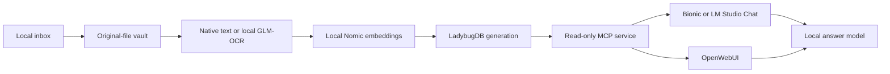

# Local context with LadybugDB and MCP

By **Maks Khomutskyi**.

I built this context layer to keep my documents useful across local chats, at home and while traveling. It preserves original files, stores text, vectors and explicit document links in LadybugDB, and exposes bounded evidence through read-only MCP tools.

This repository contains application source and fictional examples. It contains no personal library, extracted personal text, embeddings, chat history, credentials, model weights or private test exports.

Start with the [fictional House Orchid demo](#prerequisites-once-then-one-startup-command), then [connect a chat client](#connect-a-chat-client). Use a separate private state directory when you are ready to add your own files.

## What I tested

| Workflow | Recorded result |
|---|---|
| Windows Bionic and LM Studio Chat | Search, graph traversal, evidence reads and correct cited fictional answers |
| Windows LM Studio Chat with networking disconnected | Passed the fictional acceptance question |
| MacBook Air M5, 32 GB, native MLX models | Library restored natively; 11 lifecycle tests passed |
| Mac LM Studio Chat and Bionic, offline | Both passed the primary fictional workflow with tool execution and citations |
| Mac Bionic on battery without Wi-Fi | I confirmed operation during the offline test |
| Windows OpenWebUI | Actual browser tool call and cited fictional answer passed |

The acceptance question covered a dated balance, a linked payment receipt, payment status and an absent bank account number. These are focused functional checks, not a general accuracy benchmark. Network disconnection and battery operation were owner-confirmed; battery endurance and host-wide traffic were not measured. The full personal library was restored on the Mac, but the chat acceptance checks deliberately exposed fictional records only.

The tested deployments preceded this sanitized source release. This release adds an explicit native extension path and a portable startup wrapper. Its release checks are recorded in [VALIDATION.md](VALIDATION.md); do not treat the earlier Mac pass as a clean-machine test of every packaging change.

## Architecture



Retrieval combines exact cosine similarity, literal keyword ranking and explicit document links. It uses scoped exact scanning for this small library. Although vector and full-text indexes are built, the current search path is not an ANN or BM25 benchmark. The default evidence allowance is about 2,000 tokens, capped at 4,000 and eight chunks per search. This is an evidence budget, not a cap on total conversation tokens.

## Prerequisites once, then one startup command

Use Python 3.11–3.14. Create an environment and install the pinned requirements:

```text
python -m venv .venv
# Windows: .venv\Scripts\python.exe -m pip install -r requirements.txt
# macOS/Linux: .venv/bin/python -m pip install -r requirements.txt
```

Use that environment's Python for the commands below. Package installation can require Internet access; runtime does not silently install packages or models.

Before going offline, prepare these local assets:

1. LM Studio's local server and the original installed chat and embedding models. Inspect `lms ls --json` and `lms ps --json`; use their exact canonical API IDs. No model aliases or automatic downloads are created here.
2. Native **LadybugDB 0.22.1 vector and fts extensions** for your operating system and architecture. Reuse the installed files. Pass their parent directory with `--extensions`; it must contain `libvector.lbug_extension` and `libfts.lbug_extension`, directly or in `vector/` and `fts/` subdirectories. Windows native libraries cannot be reused on an Apple Silicon Mac. If installation is needed, use the official [extension installation instructions](https://docs.ladybugdb.com/extensions/) on an empty database before processing private data. The service itself never issues `INSTALL`.
3. The **cl100k_base tokenizer cache**, with the upstream content hash checked by the application. Reuse an existing cache directory. If needed, prepare it online by setting `TIKTOKEN_CACHE_DIR` to a private cache directory, then run `python -c "import tiktoken; tiktoken.get_encoding('cl100k_base')"`. Pass the same directory with `--token-cache`.

The embedding implementation expects Nomic Embed Text v1.5's `search_document:` / `search_query:` prefixes and 768-dimensional vectors. Choose that embedding model's installed canonical ID; this is not an arbitrary-embedding adapter. Changing an embedding model requires rebuilding compatible vectors.

First run, using a new private state directory outside this checkout:

```text
python run.py --home /PRIVATE/DEMO-STATE --model-origin http://127.0.0.1:1235 --chat-model CANONICAL_CHAT_ID --embedding-model CANONICAL_NOMIC_ID --extensions /LOCAL/NATIVE/EXTENSIONS --token-cache /LOCAL/TOKEN/CACHE --demo --check
```

Replace the paths and IDs with your local values. On Windows, use absolute Windows paths and quote paths containing spaces. `--demo` adds only two fictional records to an empty library and refuses an existing library. `--check` prints aggregate status and exits; it does not leave an MCP server running. Startup generates the bearer token locally and preserves the original model IDs. No private settings file belongs in Git.

After initialization, start the same service with one command:

```text
python run.py --home /PRIVATE/DEMO-STATE --extensions /LOCAL/NATIVE/EXTENSIONS --token-cache /LOCAL/TOKEN/CACHE --transport http
```

This starts MCP at `http://127.0.0.1:8765/mcp`. Omit `--demo` on subsequent runs. Existing settings are reused; conflicting model or endpoint arguments are rejected. Ctrl+C stops the native service. Do not run a second service against the same deployment port.

The public startup command runs a **native context service on the host**. It does not create a Docker network or a chat interface on port 8780.

| Setup | Context service | Chat interface |
|---|---|---|
| This public native entry point | Host loopback, port 8765 | Connect an existing client separately |
| My tested Windows Docker deployment | Internal container network, proxy on host port 8765 | Existing OpenWebUI on host port 8780 |

These examples use the same context port, so do not start both deployments on that port at once. This native entry point does not install Docker, configure OpenWebUI, download model weights, set up account access or migrate your other installations. The original Windows deployment also uses an isolated Docker stack and fixed local file broker; those machine-specific containers and private mounts are not redistributed.

## Connect a chat client

For an HTTP MCP client, configure `http://127.0.0.1:8765/mcp`, Streamable HTTP, and the bearer token from your local state directory's `settings.json`. The model API is a separate connection. With HTTP mode, this service exposes its fixed local model bridge at `http://127.0.0.1:8765/v1` too.

For a stdio client, use your environment's absolute Python path as the command and these arguments:

```json
[
  "/ABSOLUTE/PATH/TO/run.py",
  "--home", "/PRIVATE/DEMO-STATE",
  "--extensions", "/LOCAL/NATIVE/EXTENSIONS",
  "--token-cache", "/LOCAL/TOKEN/CACHE",
  "--transport", "stdio"
]
```

Initialize the demo first. Bionic and LM Studio Chat must execute the MCP tools; a local model API alone is not an MCP client. For OpenWebUI, configure native function calling, a local model connection and MCP Streamable HTTP. Its deployment must be able to reach the MCP address: `127.0.0.1` inside a container refers to that container, not the host. Use an intentionally configured local container network for a containerized setup. Do not expose an unauthenticated family service to the LAN or Internet.

Ask this fictional test question:

> Use only the local context tools with scope synthetic. Search House Orchid. Follow the statement-to-receipt relationship with related_documents, then read the evidence with get_evidence. What is the balance, as of what date, and was payment received or overdue? Is a bank account number provided? Cite returned chunk IDs as plain text. If tools are unavailable, say so.

Expected facts: **127 dollars as of 6 November 2026; payment received on 5 November, not overdue; no bank account number provided.** IDs in this demo are generated during ingestion; cite the IDs actually returned. The comic's fictional amount is not this test's ground truth.

## Add your own files locally

Use a separate private state directory for real records. `/PRIVATE/DEMO-STATE` above holds the fictional demo; `/PRIVATE/STATE` below stands for your real library. Replace these placeholders with different absolute local paths. On Windows, use a path such as `C:\LocalContext\private-library` and quote paths containing spaces.

Run `run.py` with the real library's `--home`, without `--demo`, to initialize it. Use the same Python environment throughout. Startup's `--extensions` and `--token-cache` arguments apply to that process; management commands need the corresponding environment settings in their own shell:

```powershell
# Windows PowerShell: replace both example paths with your existing assets.
$env:CONTEXT_EXTENSION_DIR='C:\LocalAssets\ladybug-extensions'
$env:TIKTOKEN_CACHE_DIR='C:\LocalAssets\tiktoken'
```

```sh
# macOS/Linux: replace both paths with your existing native assets.
export CONTEXT_EXTENSION_DIR="/LOCAL/NATIVE/EXTENSIONS"
export TIKTOKEN_CACHE_DIR="/LOCAL/TOKEN/CACHE"
```

Put inputs in the real library's `inbox/`, then run:

```text
python -m context_layer.manage --home /PRIVATE/STATE ingest --scope household
python -m context_layer.manage --home /PRIVATE/STATE review
python -m context_layer.manage --home /PRIVATE/STATE snapshot
python -m context_layer.manage --home /PRIVATE/STATE withdraw DOCUMENT_ID
```

Use a document ID actually returned by your private review or tools for withdrawal; `DOCUMENT_ID` is a placeholder.

PDF text, DOCX, UTF-8 text/Markdown and CSV rows are supported. Add `--ocr` to ingest scans with the configured local GLM-OCR model. OCR remains unreviewed until you check it. CSV is indexed text, not typed spreadsheet arithmetic. No folder watcher is included.

Original bytes are hash-addressed and retained. One writer builds a new generation, then switches an atomic pointer. Failed builds preserve the previous generation. Withdrawal excludes active retrieval but does not erase originals, old generations, snapshots, queues or chat history. Keep backups on another device; same-disk snapshots are not disaster recovery.

## Privacy and access boundaries

- Personal runtime state stays outside the repository. Tokens, original files, extracted text, vectors and answers must remain local.
- Inference accepts literal loopback origins only. Redirects, environment proxies, external image URLs and arbitrary tools are refused.
- MCP returns evidence to the client. A cloud-model client can then transmit it elsewhere. Keep private questions on a local model and disable unrelated web/cloud integrations.
- Scope is a retrieval filter, not per-user authorization. The family deployment still needs tested authentication and enforced access to its shared collection.
- The application does not encrypt files at rest. Protect the account, disk and backups. Private review files and local diagnostic queues can contain sensitive content.
- An offline pass establishes that tested workflow. It is not a claim that all software on the host has zero network activity.

## Tests and attribution

With native assets prepared, set `CONTEXT_EXTENSION_DIR` and `TIKTOKEN_CACHE_DIR`, then run `python -m unittest discover -s tests -v`. Tests use fictional data and mocked model inference; they do not send personal records or download models. Keep generated test state out of commits.

Author: Maks Khomutskyi. Original application code is under the [MIT license](LICENSE). Dependencies keep their own licenses; see [THIRD_PARTY.md](THIRD_PARTY.md).
